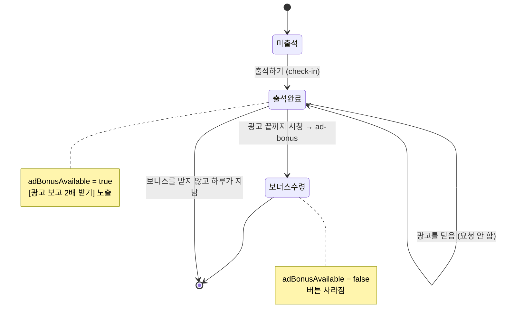
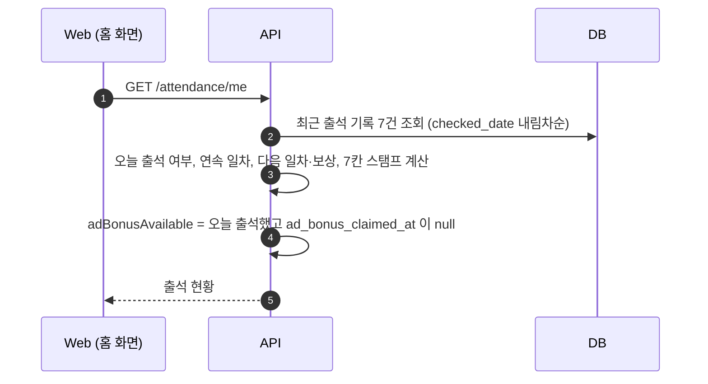
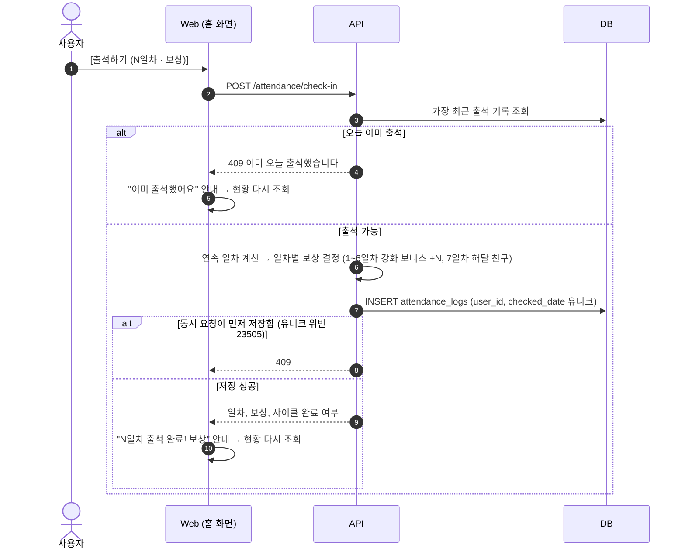
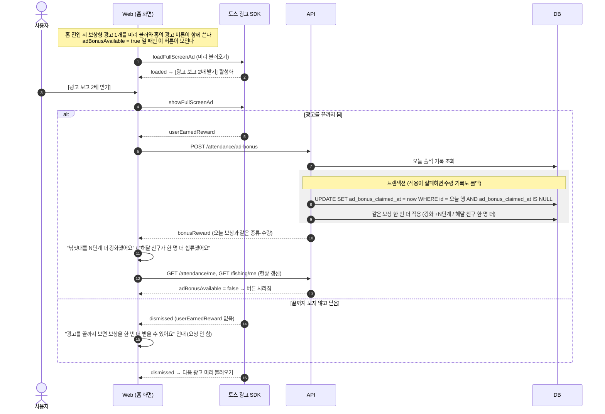

# 출석체크 데이터 시퀀스

[출석체크 설계](./attendance-check.md)의 구현(`apps/api/src/modules/attendance`, `apps/web/src/features/check-in`, `apps/web/src/pages/home`)을 바탕으로 흐름을 그린 문서다.

- 모든 요청에는 자체 access token(`Authorization: Bearer`)이 붙는다. 다이어그램에서는 생략한다. 인증 흐름은 [사용자 인증 시퀀스](./user-auth-sequence.md)를 본다.
- "하루"는 KST 00:00 기준이다. 날짜와 일차는 서버 시각으로만 계산한다.
- 보상은 낚시에 바로 적용된다 (1~6일차 낚싯대 강화, 7일차 해달 친구). 계산은 [해달 낚시 시퀀스](./fishing-sequence.md)를 본다.

## 1. 하루 상태

`attendance_logs` 한 행이 "사용자가 그날 출석한 기록"이다. 광고 보너스는 같은 행의 `ad_bonus_claimed_at`으로 기록한다.

| 상태 | 오늘 행 | `ad_bonus_claimed_at` | `adBonusAvailable` |
|---|---|---|---|
| 미출석 | 없음 | - | false |
| 출석완료 | 있음 | null | true |
| 보너스수령 | 있음 | 시각 | false |

## 2. 출석 현황 조회

연속 판정: 직전 출석이 어제이고 사이클(7일)이 진행 중이면 +1일차, 아니면 1일차부터 다시 시작한다.

## 3. 출석하기

## 4. 광고 보고 2배 받기

- 보상 조건은 `userEarnedReward`뿐이다. `dismissed`나 광고 클릭만으로는 요청하지 않는다.
- 광고를 다 본 뒤의 요청이라, 네트워크 오류나 5xx는 최대 2번 자동 재시도한다. 4xx는 재시도하지 않는다.
- 브라우저 개발(devtools mock)의 전면 광고는 `userEarnedReward`를 보내지 않는다. 그래서 브라우저에서는 "닫음" 경로만 재현되고, 보상 경로는 실기기(테스트 광고 ID)에서 확인한다.

## 5. 막히는 경우

| 요청 | 조건 | 응답 |
|---|---|---|
| 모든 요청 | 토큰 없음, 위조·만료 토큰 | 401 (웹이 한 번 재발급 후 재시도) |
| check-in | 오늘 이미 출석 | 409 |
| check-in | 같은 사용자의 동시 요청 | 먼저 저장된 1건만 성공, 나머지 409 (유니크 제약) |
| ad-bonus | 오늘 출석 기록 없음 | 404 |
| ad-bonus | 이미 보너스를 받음 | 409 |
| ad-bonus | 같은 사용자의 동시 요청 | 1건만 성공, 나머지 409 (조건부 UPDATE) |

> ⚠️ 서버는 광고 시청 여부를 직접 검증할 수 없다. 웹은 `userEarnedReward`를 받은 뒤에만 `ad-bonus`를 호출해야 한다. 서버 쪽 완화책은 "하루 1회, 오늘 출석한 경우에만"이다.
