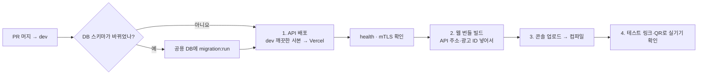
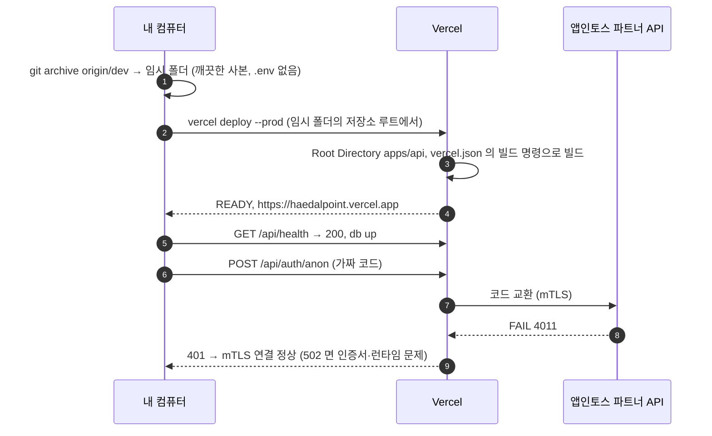
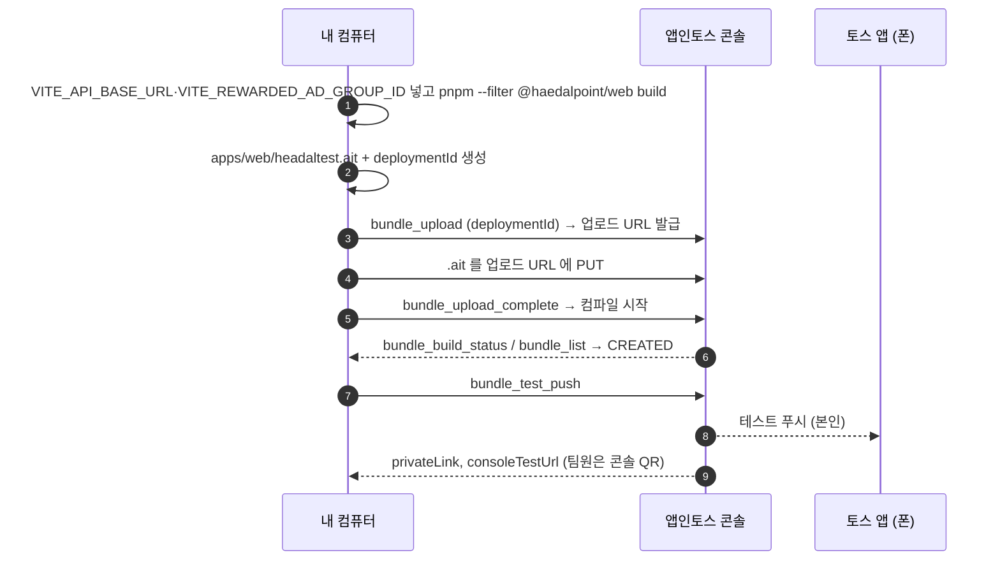

# 배포 흐름

해달해달은 두 곳에 나눠 배포한다.

| 대상 | 어디에 | 누가 서비스하나 |
|---|---|---|
| 화면 (`apps/web`) | `.ait` 번들 → 앱인토스 콘솔 | 앱인토스 (`https://headaltest.apps.tossmini.com`, QR 테스트는 `private-apps`) |
| API (`apps/api`) | Vercel 함수 (`https://haedalpoint.vercel.app/api`, 지역 `dub1`) | Vercel |
| DB | Supabase Postgres (eu-west-1) | Supabase |

화면 번들에 API 주소가 들어가므로 **API를 먼저 배포**하고 그 주소로 번들을 만든다.



## 0. DB 마이그레이션 (스키마가 바뀐 PR만)

코드와 스키마가 어긋나지 않도록 **PR 머지와 같은 시점에** 공용 DB에 적용한다.

```bash
pnpm --filter @haedalpoint/api migration:run   # apps/api/.env 의 DATABASE_URL 대상
```

## 1. API 배포 (Vercel)

Vercel 프로젝트는 Git 연동 없이 CLI 로 배포한다 (팀 범위 `chan-s-children`, 프로젝트 `haedalpoint`).



- **깨끗한 사본에서 배포하는 이유:** CLI 는 내 컴퓨터의 파일을 올린다. Vercel 문서상 기본 제외 목록에 `.env.local`은 있지만 **일반 `.env`는 없다.** 작업 폴더에서 바로 배포하면 `apps/api/.env`(DB 비밀번호, JWT 키)가 올라갈 수 있다.
- **처음 한 번만:** 임시 폴더에서 `vercel link --yes --project haedalpoint --scope chan-s-children`로 프로젝트를 연결한다. 이후에는 `.vercel/` 폴더를 새 사본에 복사해 쓴다.

```bash
git fetch origin
rm -rf /tmp/haedal-deploy && mkdir -p /tmp/haedal-deploy
git archive origin/dev | tar -x -C /tmp/haedal-deploy
cp -R <이전 사본>/.vercel /tmp/haedal-deploy/.vercel        # 처음이면 위의 vercel link
cd /tmp/haedal-deploy && npx vercel deploy --prod --yes --scope chan-s-children

curl https://haedalpoint.vercel.app/api/health
curl -X POST -H 'Content-Type: application/json' -d '{"code":"invalid-check"}' \
  https://haedalpoint.vercel.app/api/auth/anon                 # 401 이면 정상
```

### Vercel 설정

| 항목 | 값 | 어디서 |
|---|---|---|
| Root Directory | `apps/api` | 대시보드 Settings → Build and Deployment (CLI·`vercel.json`으로는 설정 불가) |
| Framework, 빌드 명령, 지역 | `nestjs`, `cd ../.. && pnpm turbo run build --filter=@haedalpoint/api`, `dub1` | `apps/api/vercel.json` |

### Vercel 환경 변수 (Production)

| 이름 | 유형 | 비고 |
|---|---|---|
| `NODE_ENV` | Config | `production` |
| `DB_SSL` | Config | `true` |
| `CORS_ORIGIN` | Config | `https://headaltest.apps.tossmini.com,https://headaltest.private-apps.tossmini.com` |
| `DATABASE_URL` | Secret | Supabase 접속 문자열 |
| `JWT_SECRET` | Secret | 로컬과 다른 값 |
| `TOSS_MTLS_CERT_BASE64` | Secret | `base64 -i <이름>_public.crt \| tr -d '\n'` |
| `TOSS_MTLS_KEY_BASE64` | Secret | `base64 -i <이름>_private.key \| tr -d '\n'` |

`TOSS_PARTNER_API_BASE_URL`은 넣지 않는다 (기본값이 공식 주소). production 은 공식 주소와 인증서가 없으면 서버가 뜨지 않는다.

## 2~4. 화면 번들 (앱인토스 콘솔)



```bash
cd apps/web
VITE_API_BASE_URL=https://haedalpoint.vercel.app/api \
VITE_REWARDED_AD_GROUP_ID=ait-ad-test-rewarded-id \
pnpm build      # → apps/web/headaltest.ait, 로그에 deploymentId
```

- 업로드부터 테스트 링크까지는 `/ait:test-on-device`(콘솔 MCP)로 하거나 콘솔 웹에서 한다.
- **광고 ID:** QR 테스트에는 테스트 ID(`ait-ad-test-rewarded-id`)를 쓴다. 실제 ID로 테스트하면 정책 위반이다. **출시 번들에는 콘솔에서 발급한 운영용 광고 그룹 ID**를 넣는다.
- **appName:** `apps/web/apps-in-toss.config.ts`의 `headaltest`가 콘솔 앱과 같아야 컴파일된다.
- **QR 테스트 조건:** 토스 앱 로그인, 워크스페이스 멤버(구성원이면 앱 권한 필요), 만 19세 이상.
