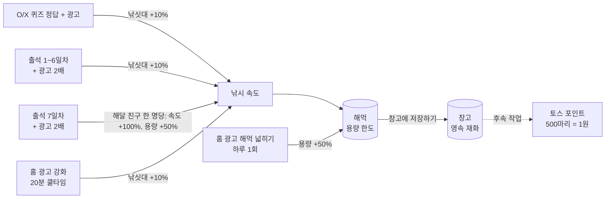
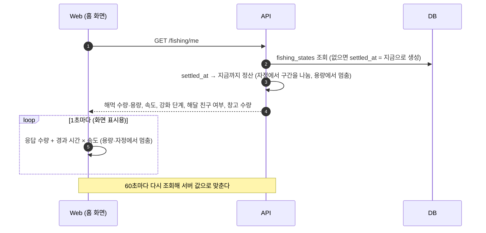
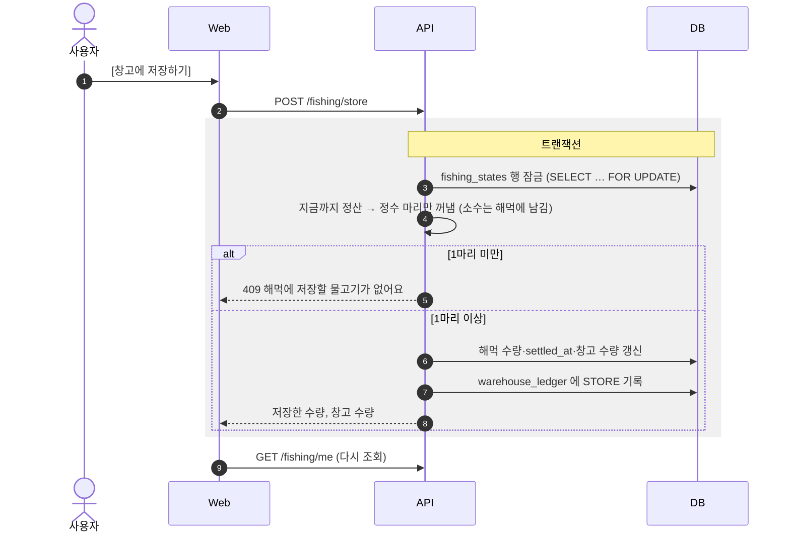
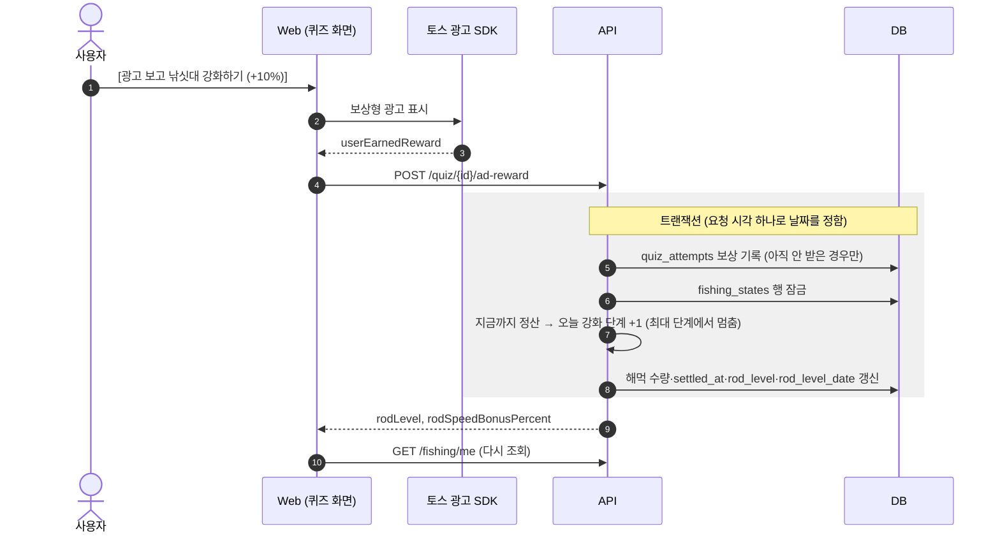
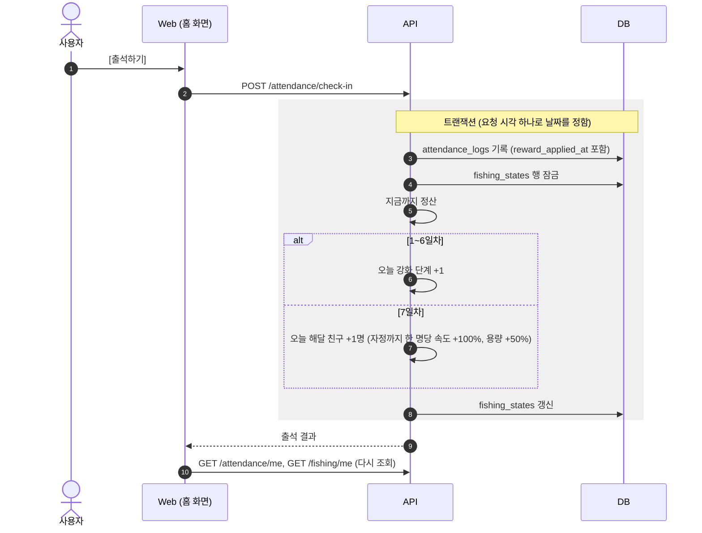
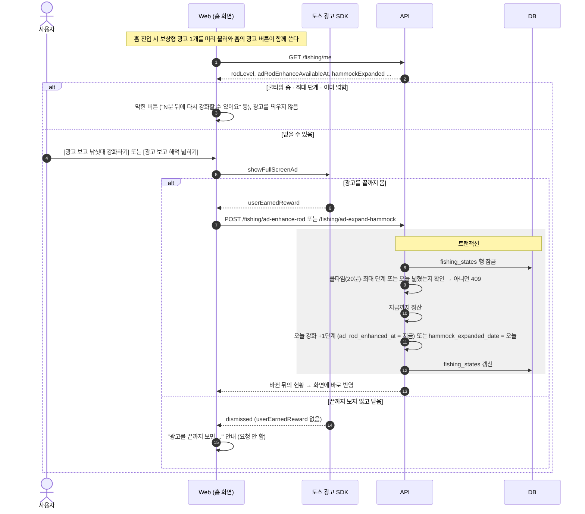
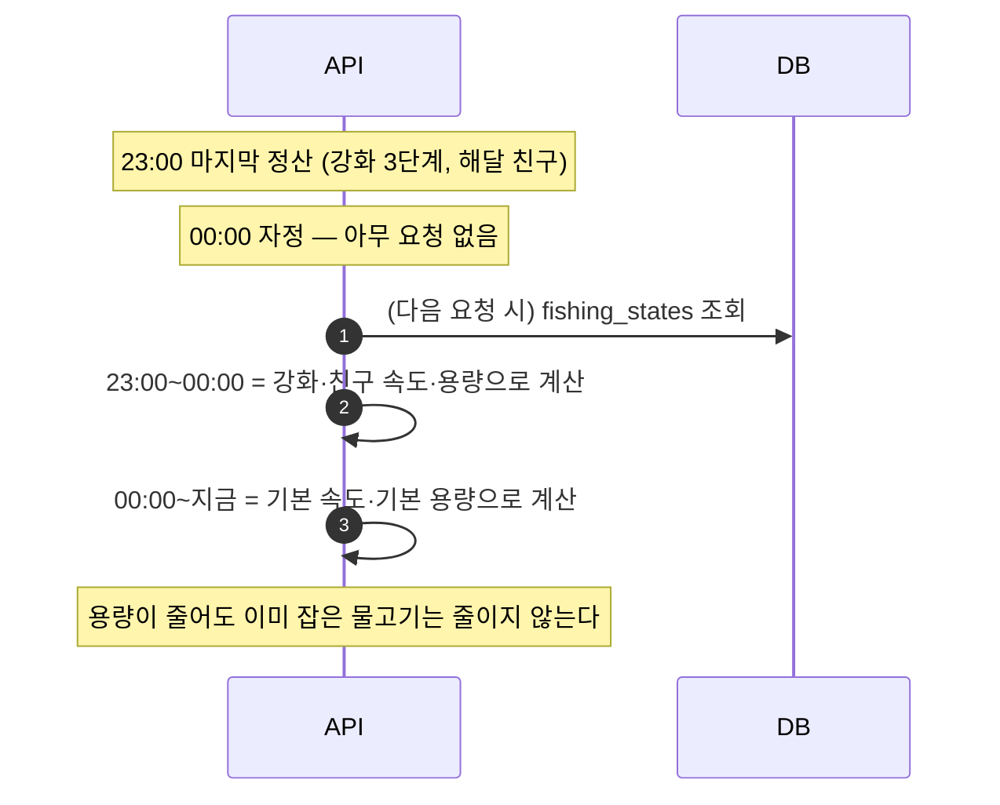

# 해달 낚시 데이터 시퀀스

[해달 낚시 설계](./fishing.md)의 구현(`apps/api/src/modules/fishing`, `apps/web/src/entities/fishing`, `apps/web/src/features/store-fish`, `apps/web/src/features/fishing-ad-boosts`)을 바탕으로 흐름을 간략히 그린 문서다.

- 모든 요청에는 자체 access token(`Authorization: Bearer`)이 붙는다. 다이어그램에서는 생략한다. 인증은 [사용자 인증 시퀀스](./user-auth-sequence.md)를 본다.
- 물고기 수량은 **서버가 시각으로 계산**한다. 클라이언트는 수량을 보내지 않는다.
- "하루"는 KST 00:00 기준이다. 낚싯대 강화·해달 친구·해먹 넓히기는 자정에 풀린다.

## 1. 전체 흐름

## 2. 해먹 현황 조회

조회는 계산만 하고 DB에 쓰지 않는다. 처음 들어온 사용자면 이때 `fishing_states` 행을 만들고 낚시가 시작된다.

## 3. 창고에 저장하기

같은 사용자의 요청이 동시에 와도 행 잠금 때문에 차례로 처리되고, 두 번째 요청은 꺼낼 물고기가 없어 409가 된다.

## 4. 퀴즈 광고 보상 → 낚싯대 강화

## 5. 출석 → 낚싯대 강화 / 해달 친구

출석 '광고 보고 2배'(`POST /attendance/ad-bonus`)도 같은 트랜잭션 구조다. `ad_bonus_claimed_at` 조건부 UPDATE와
같은 보상 한 번 더(1~6일차 강화 +1단계, 7일차 해달 친구 한 명 더)를 함께 처리하고, 적용이 실패하면 수령 기록도 롤백된다.

## 6. 홈 광고 부스트 (낚싯대 강화 · 해먹 넓히기)

## 7. 자정 처리

배치 작업은 없다. 강화·해달 친구·해먹 넓히기에는 유효 날짜(`rod_level_date`, `otter_friend_date`, `hammock_expanded_date`)가 있고, 정산할 때 자정에서 구간을 나눠 계산한다.

