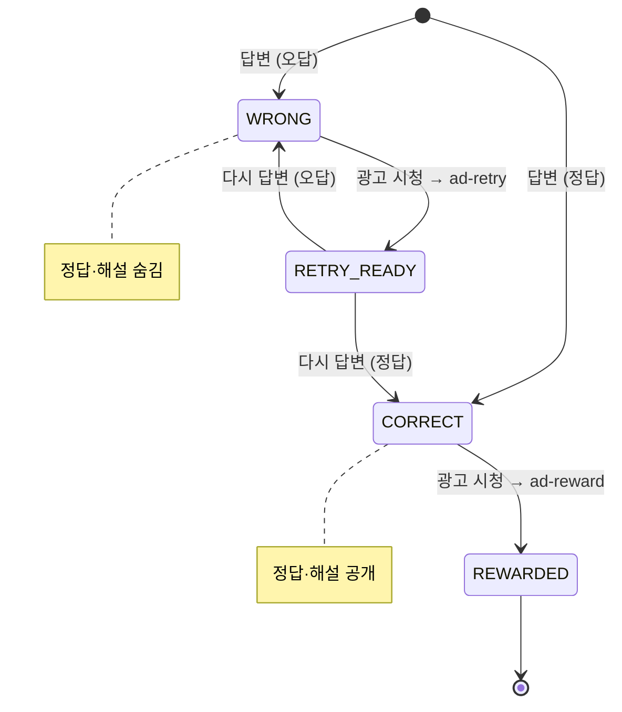
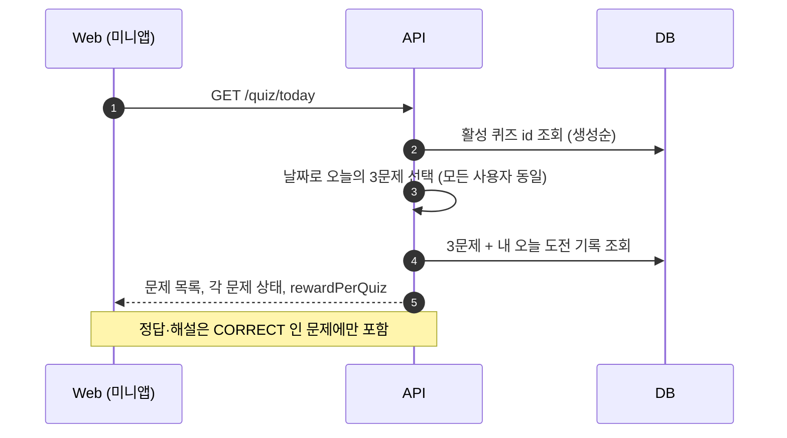
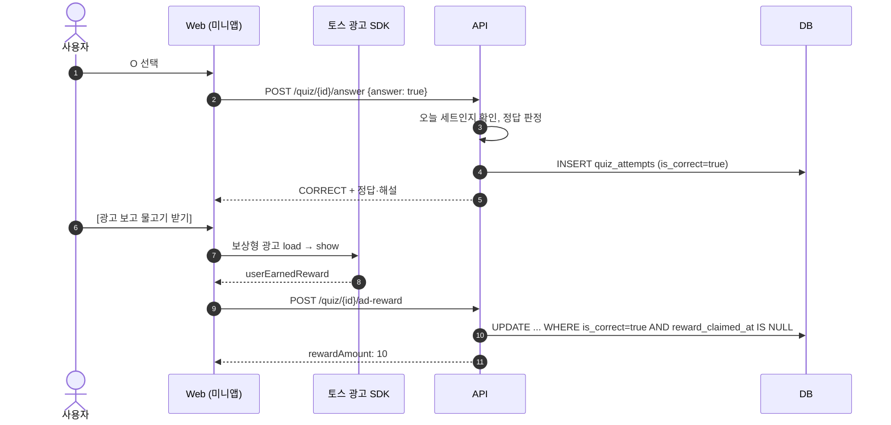
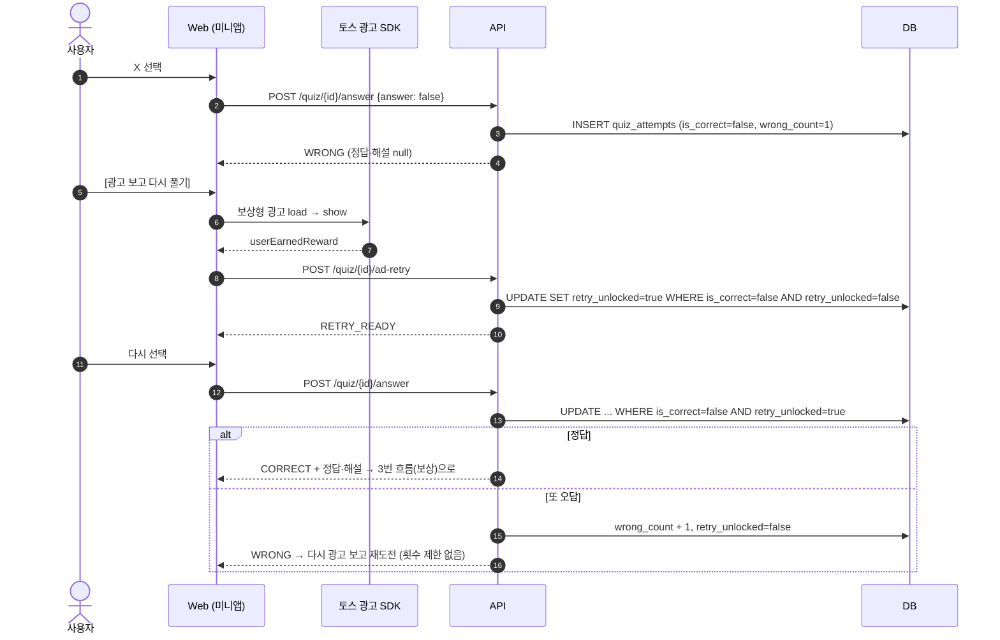

# O/X 퀴즈 데이터 시퀀스

[O/X 퀴즈 설계](./ox-quiz.md)의 구현(`apps/api/src/modules/quiz`)을 바탕으로 데이터 흐름을 단순화해 그린 문서다.

- API 쪽은 구현 기준이다. Web·광고 SDK 쪽은 이후 PR(② 퀴즈 화면, ③ 보상형 광고)에서 구현할 예정이다.
- 모든 요청에는 임시 사용자 식별 헤더 `X-User-Id`가 붙는다. 다이어그램에서는 생략한다.
- "하루"는 KST 기준이다.

## 1. 도전 상태

`quiz_attempts` 한 행이 "사용자가 그날 한 퀴즈에 도전한 기록"이다. 재도전하면 같은 행을 갱신한다.

| 상태 | `is_correct` | `retry_unlocked` | `reward_claimed_at` |
|---|---|---|---|
| WRONG | false | false | null |
| RETRY_READY | false | true | null |
| CORRECT | true | false | null |
| REWARDED (`status`는 CORRECT, `rewardClaimed: true`) | true | false | 시각 |

## 2. 오늘의 퀴즈 조회

## 3. 정답 → 광고 → 보상

## 4. 오답 → 광고 → 재도전

## 5. 막히는 경우 (409 / 404)

| 요청 | 조건 | 응답 |
|---|---|---|
| answer | 오늘 세트에 없는 퀴즈 | 404 |
| answer | WRONG 상태 (재도전 광고를 안 봄) | 409 |
| answer, ad-retry | 이미 CORRECT | 409 |
| ad-retry | 이미 RETRY_READY | 409 |
| ad-retry, ad-reward | 답변 기록 없음 | 404 |
| ad-reward | 아직 맞히지 않음 | 409 |
| ad-reward | 이미 보상 받음 | 409 |

같은 요청이 동시에 들어와도 위 조건부 UPDATE(첫 답변은 유니크 제약)로 한 번만 반영되고, 나머지는 409를 받는다.

> ⚠️ 서버는 광고 시청 여부를 검증할 수 없다. Web은 `userEarnedReward`를 받은 뒤에만 `ad-retry`·`ad-reward`를 호출해야 한다. (`dismissed`만으로 호출 금지)
