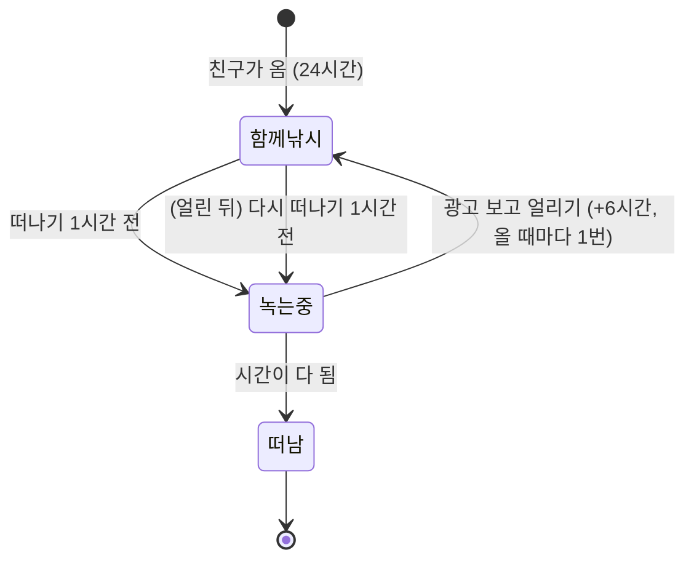

# 눈사람 친구: 출석으로 만들고, 녹으면 광고로 얼린다

- 상태: 서버·웹 구현. DB 마이그레이션(`OtterFriendFreeze`)과 API·번들 배포는 아직
- 작성일: 2026-11-18
- 배경: 해달 친구를 3D 눈사람으로 바꿨다 (PR #59). 눈사람이라는 소재를 살려
  ① 출석할수록 눈사람이 만들어지고 ② 떠날 때가 되면 녹아내리며 ③ 광고를 보고 얼려 더 머물게 하는 연출을 넣는다.
- 관련 문서: [attendance-check.md](./attendance-check.md), [fishing.md](./fishing.md), [tutorial.md](./tutorial.md)
- 기준: 코드·API 이름은 `otterFriend` 그대로 둔다 (화면 글자만 "눈사람 친구"로 바꾼다. 해먹 → 양동이 때와 같다)

## 1. 정한 것 (2026-11-18)

| 항목 | 결정 |
|---|---|
| 녹기 시작 | 떠나기 **1시간 전**부터 |
| 얼리기 | 녹는 동안 **광고를 보면 6시간 연장**, 친구가 **올 때마다 1번** |
| 튜토리얼 친구와 겹칠 때 | 친구가 와 있으면 살아 있는 눈사람, 떠나면 출석 단계의 "만드는 중" 눈사람 ("녹아서 떠났고, 다시 만든다") |
| 반복 | **7일 주기**. 눈사람(친구)만 반복하고 토스 포인트·강화 보상은 그대로 둔다 (방법 B) |

## 2. 출석 보상 (바뀌는 것은 7의 배수 일차뿐)

| 누적 일차 | 지금 | 바꾼 뒤 |
|---|---|---|
| 1~6 | 토스 포인트 1원 | 그대로 |
| 7 | 친구 24시간 | 그대로 |
| 8~13, 15~20 … | 낚싯대 +10단계 | 그대로 |
| **14, 21, 28 …** | 낚싯대 +10단계 | **친구 24시간** (그날 강화 +10단계는 주지 않는다) |

- 토스 포인트 지급은 지금처럼 사용자당 평생 6원이다. 프로모션 발행액 보고에 영향이 없다.
- 7의 배수 일차에 강화까지 함께 주지 않는 이유: 그날 보상을 "눈사람이 살아난다" 하나로 보여 주기 위해서다.
  친구(+50%)가 강화 10단계(+10%)보다 크므로 사용자에게 불리하지 않다.

### 눈사람 만들기 단계

`cycleDay = 누적 출석 일수 % 7` (0~6). 서버가 계산해 내려준다 (정책이 서버에만 있게).

| cycleDay | 눈밭에 보이는 것 (친구가 와 있지 않을 때) |
|---|---|
| 0 | 없음 (아직 출석 전이거나, 지난 눈사람이 녹아 떠난 뒤) |
| 1 | 작은 눈덩이 |
| 2 | 큰 몸통 |
| 3 | 머리를 올림 |
| 4 | 나뭇가지 팔 |
| 5 | 눈·당근 코·단추 |
| 6 | 목도리·모자 (완성, 아직 가만히 있다) |

- 7의 배수 일차에 출석하면 완성된 눈사람이 살아나 친구가 된다.
- **친구가 와 있는 동안은 단계와 상관없이 살아 있는 눈사람**을 그린다 (튜토리얼 친구, 또는 7일차 친구가 있는 채로 다음 날 출석한 경우).
  친구가 떠나면 그때의 cycleDay 단계를 그린다.
- 만드는 중인 눈사람은 장식이다. 속도·용량에 영향이 없고 누를 수 없다.

## 3. 녹는 눈사람과 얼리기

- **녹는 중**: 남은 시간이 60분 이하. 통째로 눌러 찌그러뜨리지 않고, 몸통 위쪽은 가라앉고 아래쪽은 울퉁불퉁하게 흘러 퍼지게 한다 (남은 시간에 비례).
  머리·팔·목도리·단추가 무너지는 몸을 따라 내려가고, 모자는 옆으로 미끄러지며 기운다. 물방울이 떨어지고 발밑에 물웅덩이가 번진다. 표정은 걱정스러운 눈썹.
  녹은 모양은 모델 파일에 넣지 않고 불러온 뒤 계산해 붙인다 (`snowman-melt.ts`, 모델 용량이 늘지 않는다).
  녹는 동안에도 친구 효과(속도 +50%, 양동이 +10%)는 그대로다.
- **말풍선**: 눈사람 머리 위에 "눈사람을 도와주세요!" + 버튼 "광고 보고 얼려주기 · 6시간 더".
  광고가 나온다는 것을 누르기 전에 알 수 있어야 한다 (apps/web/AGENTS.md: 다크패턴 금지). 눈사람을 눌러도 같은 동작이다.
- **얼리기**: 보상형 광고를 끝까지 본 뒤(`userEarnedReward`) 서버에 요청한다. 떠나는 시각이 6시간 늘고, 눈사람이 얼음 조각과 함께 원래 모습으로 돌아온다.
- **이미 얼린 뒤 다시 녹을 때**: 말풍선·버튼 없이 녹는 모습만 보인다 ("올 때마다 1번").
- 랜덤 보상이 아니다 (항상 6시간). 기존 "광고 보고 낚싯대 강화"와 같은 고정 보상 구조다.

## 4. 서버

### 정책값 (`apps/api/src/common/globals/`)

| 이름 | 값 | 뜻 |
|---|---|---|
| `OTTER_FRIEND_POLICY.MELT_MINUTES` | 60 | 떠나기 이만큼 전부터 녹는다 (얼릴 수 있다) |
| `OTTER_FRIEND_POLICY.FREEZE_HOURS` | 6 | 얼리면 늘어나는 시간 |
| `ATTENDANCE_POLICY.OTTER_FRIEND_CYCLE_DAYS` | 7 | 친구가 오는 주기 (`OTTER_FRIEND_DAY` 를 대신한다) |

### DB (`fishing_states`, 마이그레이션 1건)

| 컬럼 | 타입 | 뜻 |
|---|---|---|
| `otter_friend_frozen` | boolean, default false | 이번에 온 친구를 이미 얼렸는지. 친구가 새로 올 때 false 로 되돌린다 |

- 친구가 이미 와 있을 때 또 오면(더 늦게 떠나는 쪽으로 맞춤) 새로 온 것으로 보고 false 로 되돌린다.

### API

| 메서드 | 경로 | 설명 |
|---|---|---|
| POST | `/fishing/ad-freeze-friend` | 광고를 본 뒤 호출. 친구가 와 있고, 녹는 중이고, 아직 얼리지 않았을 때만 6시간 연장. 아니면 409 |

- 순서: 해먹 정산(지금 시각) → 조건 확인 → `otter_friend_until += 6시간`, `otter_friend_frozen = true`. 기존 광고 강화와 같이 한 트랜잭션.
- 응답은 연장 뒤의 낚시 현황 (`FishingStatus`).

### 응답에 더하는 값

| 응답 | 필드 | 뜻 |
|---|---|---|
| `FishingStatus` | `otterFriendMeltsAt: string \| null` | 녹기 시작하는 시각 (떠나는 시각 − 60분). 친구가 없으면 null |
| `FishingStatus` | `otterFriendFreezable: boolean` | 지금 얼릴 수 있는지 (녹는 중 + 아직 안 얼림). 시각이 지나면 화면이 `otterFriendMeltsAt` 으로 다시 판단하고, 서버가 최종 확인한다 |
| `FishingStatus` | `otterFriendFrozen: boolean` | 이번에 온 친구를 이미 얼렸는지. 화면은 false → true 로 바뀔 때 얼리는 연출을 보여 준다 |
| `FishingStatus` | `otterFriendFreezeHours: number` | 얼리면 더 머무는 시간 (버튼 문구에 쓴다) |
| `AttendanceStatusResponse` | `friendCycleDay: number` | 이번 주기의 며칠째인지 (0~6). 눈사람 만들기 단계 |
| `AttendanceStatusResponse` | `repeatingWeek: AttendanceReward[]` | 첫 주가 지난 뒤 7일 묶음의 칸별 보상 (강화 6번 + 친구). 출석 화면이 8일차 이후 묶음을 그릴 때 쓴다 |

### 월 예산 (`fishing-budget.spec.ts`)

- 친구가 머무는 날 최악값: 지금 2일(7일차 + 튜토리얼) → **한 달 최대 5번 × (24시간 + 6시간) = 6.25일**
  (31일 안에 7의 배수 일차가 최대 5번. 튜토리얼 친구는 첫 달에만 있고 그 달은 7의 배수 일차가 4번이라 합쳐도 5번)
- 7의 배수 일차에는 강화 10단계를 주지 않지만, 최악값 계산은 보수적으로 지금처럼 매일 준다고 둔다.
- 테스트 이름·기댓값(`MAX_OTTER_FRIEND_DAYS` 2 → 6.25)을 고치고, 월 5,000원 한도 안인지 확인한다.

## 5. 화면 (`apps/web`)

| 부분 | 내용 |
|---|---|
| 눈사람 모델 | 녹는 자세(주저앉기·팔 처짐·걱정하는 눈썹) 코드로, 물웅덩이·얼음 조각·눈썹 부품 추가 (147KB → 162KB). 만들기 단계는 기존 부품을 켜고 끄기만 한다. 녹는 동안에는 잡는 시늉과 친구 몫 글자를 보여 주지 않는다 |
| 말풍선·버튼 | 캔버스가 아니라 장면 위 화면 요소로 얹는다 (글자 선명, 화면 낭독기, 터치 44px 이상). 눈사람 머리 위치를 따라간다 |
| 광고 | 기존 보상형 광고 훅을 쓴다. 광고를 끝까지 본 뒤에만 API 호출 |
| 내려받기 | 눈사람 모델을 출석 1일차부터 받게 된다 (지금은 친구가 있을 때만). 162KB |
| 글자 | "해달 친구" → "눈사람 친구" (출석 칸·출석 요약·오늘의 강화·튜토리얼 마지막 말) |

### 문구

| 자리 | 문구 |
|---|---|
| 말풍선 | 눈사람을 도와주세요! |
| 버튼 | 광고 보고 얼려주기 · 6시간 더 |
| 얼린 뒤 | 꽁꽁 얼었어요! 6시간 더 함께 낚시해요 |
| 오늘의 강화 (친구 줄) | 오후 3:04까지 함께 낚시해요 → 녹는 중이면 "곧 녹아요 · 오후 3:04까지" |
| 출석 7번째 칸 | 친구 → 눈사람 |

## 6. 만드는 순서

1. 서버: 정책값·마이그레이션·`ad-freeze-friend`·응답 필드·예산 테스트
2. 서버: 출석 7일 주기(`rewardForDay`)와 `friendCycleDay`, 출석 테스트
3. Blender: 물웅덩이·얼음 조각 추가, glb 다시 내보내기
4. 웹: 눈사람 녹는 자세·얼리는 연출, 만들기 단계
5. 웹: 말풍선·버튼·광고 연결, 문구 변경
6. 로컬에서 시각을 당겨 가며 확인 → 번들·API 배포

## 7. 아직 정하지 않은 것

- **녹는 1시간을 놓치면**: 친구는 온 시각의 24시간 뒤에 떠나므로, 얼릴 수 있는 때는 대략 "어제 출석한 시각의 23~24시간 뒤"다.
  매일 비슷한 시각에 들어오는 사람은 볼 수 있지만, 놓치기 쉽다면 60분을 늘리거나(예: 3시간) 떠난 뒤에도 잠깐 기회를 줄지 정한다.
- **친구가 있는 채로 7의 배수 일차에 출석**: 지금 규칙대로 "더 늦게 떠나는 쪽"으로 맞춘다 (새로 24시간, 다시 얼릴 수 있음). 튜토리얼 친구가 있는 첫날에는 해당 없음.
- **출석 화면의 7칸 묶음**: 8일차 이후 묶음의 7번째 칸을 "강화"에서 "눈사람"으로 바꾼다 (웹 `attendance-week.ts`).
