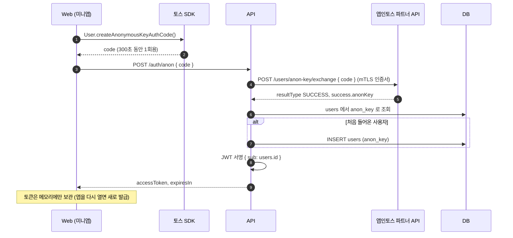
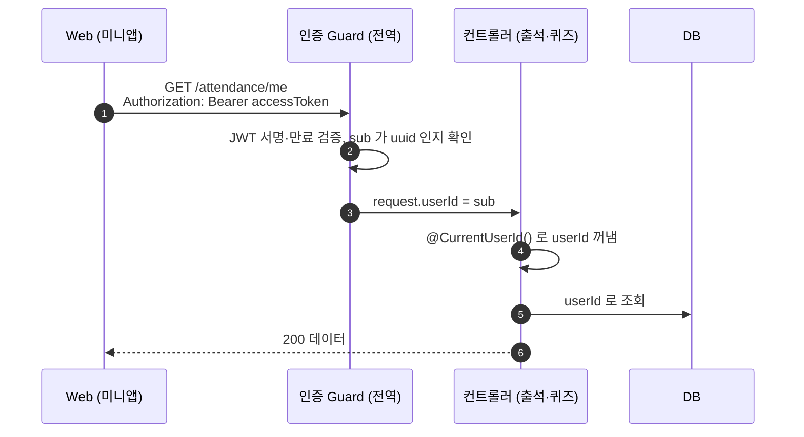
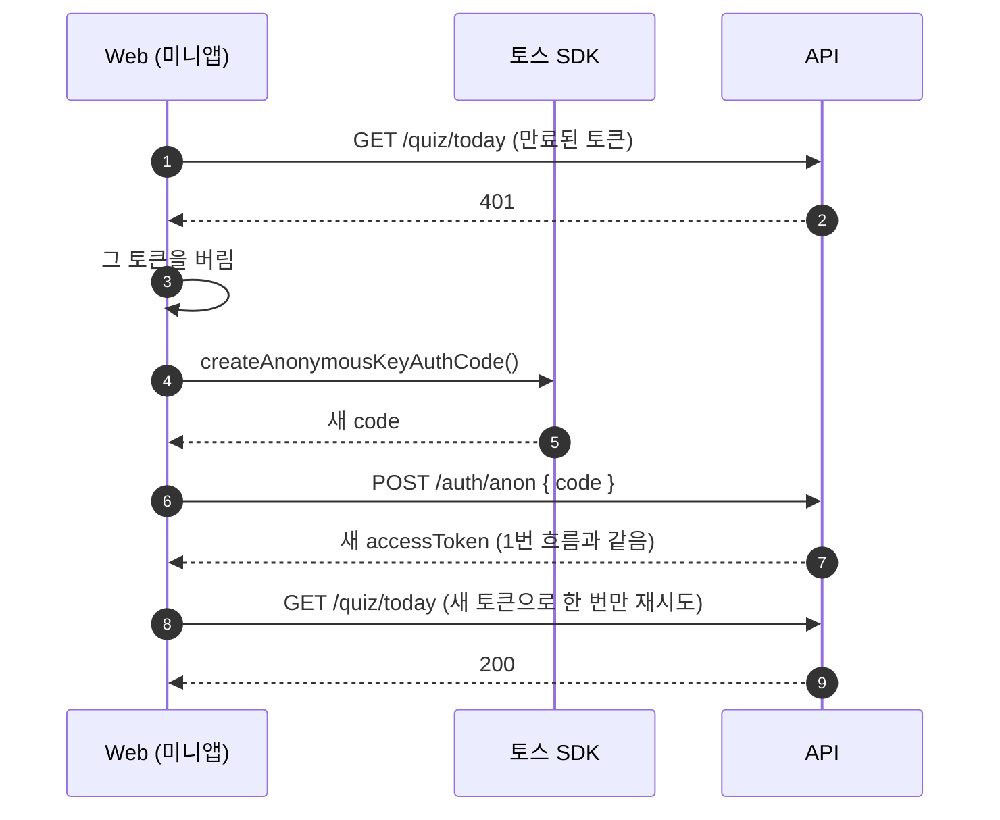
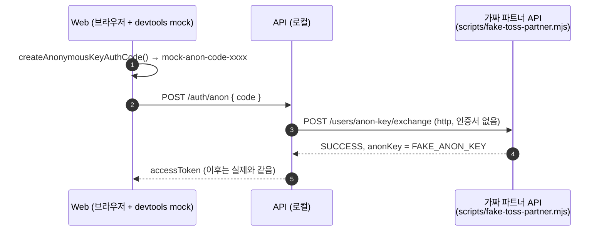

# 사용자 인증 시퀀스

[ADR-0006](../adr/0006-server-side-user-authentication.md)의 구현(`apps/api/src/modules/auth`, `apps/api/src/modules/toss-partner`, `apps/web/src/shared/api`)을 바탕으로 흐름을 그린 문서다.

- 사용자에게 로그인 화면은 없다. 화면 진입 시 뒤에서 자동으로 인증한다.
- **토스가 주는 것은 일회용 코드**이고, 익명키는 서버가 코드를 교환해서 직접 받는다. 앱은 익명키를 받지도 보내지도 않는다.
- 앱이 서버에 내는 신분증은 **우리 서버가 발급한 access token(JWT)** 이다. 토큰에는 내부 사용자 ID(`users.id`)만 들어 있다.

한 줄 요약: 토스가 앱에 일회용 코드를 주고 → 우리 서버가 그 코드를 토스에 보내 익명키로 바꾸고 → 앱에는 우리 토큰을 발급하고 → 이후 요청은 그 토큰으로 검증한다.

## 1. 첫 진입: 토큰 발급

- 코드는 저장하지 않고 받자마자 서버로 보낸다.
- 같은 사용자는 언제나 같은 익명키가 나오므로, 다시 들어와도 같은 `users.id`로 연결된다.
- 화면의 여러 요청이 동시에 시작돼도 발급은 한 번만 한다.

## 2. 이후 API 호출

- `@Public()`이 붙은 경로(`/auth/anon`, `/health`)만 Guard를 건너뛴다.
- 컨트롤러와 서비스는 `userId`만 알고, 토큰이나 익명키는 모른다.

## 3. 토큰 만료 → 자동 재발급

재시도는 한 번만 한다. 재발급도 실패하면 화면에 오류를 보여준다.

## 4. 로컬 개발: 가짜 파트너 API

브라우저 개발(devtools mock)에서는 SDK가 가짜 코드를 주므로 실제 파트너 API로 교환할 수 없다.
서버 코드에 우회 분기를 두지 않고, 파트너 API 주소(`TOSS_PARTNER_API_BASE_URL`)만 가짜 서버로 바꾼다.

- `FAKE_ANON_KEY`를 바꾸면 다른 테스트 사용자가 된다. `invalid`로 시작하는 코드는 4011로 거부한다.
- production은 공식 주소(`https://apps-in-toss-api.toss.im`)와 mTLS 인증서 경로가 없으면 서버가 뜨지 않는다.

## 5. 실패 응답

| 상황 | 응답 |
|---|---|
| 토큰 없음, Bearer 형식 아님 | 401 `인증이 필요해요` |
| 위조·만료 토큰, sub 가 uuid 아님 | 401 `인증이 만료됐거나 유효하지 않아요` |
| `POST /auth/anon`에 code 누락 | 400 |
| 코드 만료·재사용·위조 (파트너 API errorCode 4011) | 401 `인증 코드가 만료됐거나 유효하지 않아요` |
| 그 밖의 파트너 API 실패 (요청 한도 4095, TLS 오류, 시간 초과 등) | 502 `사용자 확인에 실패했어요` |

파트너 API는 실패해도 HTTP 200에 `resultType: FAIL`로 응답할 수 있으므로, 성공 판정은 `resultType === 'SUCCESS'`로 한다. 상세 사유는 서버 로그에만 남긴다.
